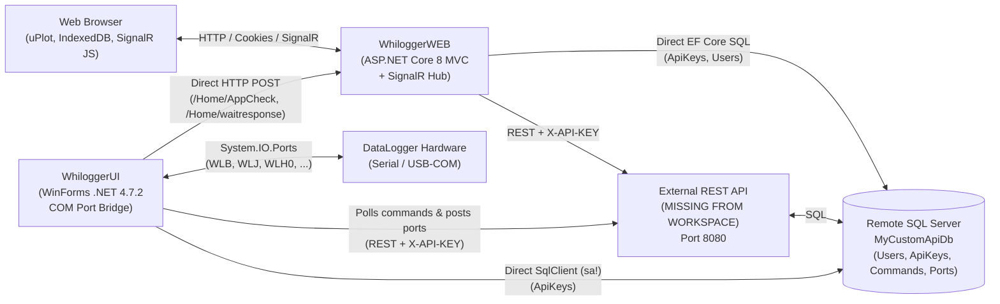

# Project Audit Report (`PROJECT_AUDIT.md` — Historical Pre-Refactor Baseline)

> [!NOTE]
> **HISTORICAL DOCUMENT (PRE-REFACTOR BASELINE):** This report documents the initial read-only audit of the three legacy internship directories (`WhiloggerWEB-master`, `WhiloggerU--master`, `WebPortApp-main`) conducted **prior** to building the modern **.NET 10 LTS** `SerialLogHub.sln` platform. All critical issues identified below have since been resolved in `src/`. For the current `.NET 10 LTS` architecture, security verification, and 52-test suite results, see [docs/FINAL_FOLLOWUP_AUDIT.md](docs/FINAL_FOLLOWUP_AUDIT.md) and [docs/FINAL_ENGINEERING_REPORT.md](docs/FINAL_ENGINEERING_REPORT.md).

> **Original Audit Date:** 2026-11-22  
> **Scope:** Full read-only technical, architectural, security, and privacy audit of all repositories in the workspace prior to any code modifications.  
> **Redaction Policy:** All sensitive values (public/private IP addresses, database credentials, API keys, JWT signing secrets, certificate thumbprints, personal names, and former employer branding) are intentionally redacted in this report.

---

## 1. Executive Summary & Critical Discovery

The workspace contains **three** directories, all written in **C# / .NET**, originally developed as an internship project for configuring and reading data from serial-connected temperature/humidity DataLogger devices:

| Folder | Actual Role (Verified from Code) | Framework / Stack | Status |
| :--- | :--- | :--- | :--- |
| `WhiloggerWEB-master` | **Web Application** (Main UI, SignalR Hub, Cookie Auth, Localization, CSV/Graphing) | ASP.NET Core 8.0 MVC + EF Core 9 + SignalR | Primary web client; depends on missing external REST API & remote SQL Server |
| `WhiloggerU--master` | **COM Port Desktop Bridge** (Local serial port discovery, command polling, serial I/O) | .NET Framework 4.7.2 Windows Forms | Primary hardware bridge; depends on missing external REST API, remote SQL Server, and local Web App |
| `WebPortApp-main` | **Legacy Standalone Web Prototype** (Direct server-side `System.IO.Ports` prototype) | ASP.NET Core 8.0 MVC | **Not the backend API.** Earlier single-tier prototype superseded by `WhiloggerWEB-master` + `WhiloggerU--master` |

### Critical Architectural Finding: Missing Backend API Project
Contrary to the initial assumption that the three folders represent *Web + API + COM Port App*, **the standalone Backend REST API (`http://<REDACTED_HOST>:8080/api/`) is not present in this workspace.**
- Both `WhiloggerWEB-master` and `WhiloggerU--master` act as HTTP clients to that external REST API (using an `X-API-KEY` header fetched directly from a shared remote SQL Server database `MyCustomApiDb`).
- `WebPortApp-main` is an older, unauthenticated ASP.NET Core MVC prototype that opens local COM ports directly inside `HomeController.cs`.

---

## 2. Per-Project Technical Analysis

### 2.1 `WhiloggerWEB-master` (Web Application)

- **Language & Runtime:** C#, ASP.NET Core MVC (`net8.0`).
- **Key Dependencies (`WhiloggerWEB.csproj`):**
  - `Microsoft.EntityFrameworkCore.SqlServer` `9.0.0` / `Microsoft.EntityFrameworkCore.Tools` `9.0.0` (version mismatch with `net8.0` target — EF Core 9 works on .NET 8, but mixing legacy and modern packages causes warnings/bloat)
  - `Newtonsoft.Json` `13.0.3`
  - `System.IO.Ports` `9.0.0` & `System.Management` `9.0.0` (**Unused** in `WhiloggerWEB-master`; leftover from `WebPortApp-main`)
  - **Obsolete / Incompatible Legacy Packages:** `Microsoft.AspNet.Mvc` `5.3.0` and `Microsoft.AspNet.SignalR` `2.4.3` (classic .NET Framework packages mistakenly installed alongside ASP.NET Core!), `Microsoft.AspNetCore.SignalR` `1.1.0`, `Microsoft.AspNetCore.Session` `2.2.0`, `Microsoft.AspNetCore.Localization` `2.2.0` (deprecated/unnecessary in .NET 8 where these are built into the shared framework)
  - `MailKit` `4.8.0` (**Unused** in source code)
  - Frontend CDN libraries: jQuery 3.6.0 (loaded **twice** in `_Layout.cshtml`), Bootstrap, Materialize CSS, uPlot, Chart.js, Plotly, DataTables, Toastr, SweetAlert2, SignalR JS 7.0.0, ExcelJS/FileSaver (referenced in `CrateTable.cshtml` without script imports).
- **Architecture:**
  - **Controllers:**
    - `HomeController`: Dashboard (`Index`), `CrateTable`, `Graph`, `KVKK`, `ChangeLanguage`, serial command relay (`Send`, `TestConnection`, `SetDelayStart`, `Getavabileport`, `Disconnect`, `GetCookie`), and webhook-like HTTP endpoints (`AppCheck`, `waitresponse`) called by the desktop app to push SignalR events to the browser.
    - `SettingsController`: Device configuration views (`AddComm`, `DelayStart`, `Calibration`, `Formatting`, `TempHum`, `Time`) and command dispatch endpoints (`SetDelayEnd`, `SetTime`, `Settocomment`, `AutoStart`, `GetBattery`, `Format`, `GetComm`, `UpdateDeviceTime`, `GetCalibrationTime`).
    - `AuthController` (`[Route("api/[controller]")]`): Proxies `register`, `login`, `logout`, `reset-password`, `ResendVerif` to the external API and issues ASP.NET Core Cookie Authentication + plain `Email` cookie.
    - `LoginController`: Renders the 3D animated Login/Register/Reset view.
    - `UserSettingsController`: Reads username directly from SQL Server (`ApplicationDbContext.Users`) and updates username via external API (`POST /updatename`).
  - **Real-Time Hub:** `Hubs/NotificationHub.cs` + `Services/UserConnectionManager.cs` maps user email (`?username=`) to SignalR `ConnectionId`.
  - **Database (`ApplicationDbContext`):** Connects directly to remote SQL Server (`MyCustomApiDb`) with only two `DbSet`s: `ApiKeys` and `Users`.
  - **Localization:** `Resources/SharedResource.*.resx` supporting 6 languages (`en-US`, `tr-TR`, `de-DE`, `hu-HU`, `hi-IN`, `zh-CN`; `fr-FR` is registered in `Program.cs` without a `.resx` file).
  - **Client-Side Storage:** Uses browser **IndexedDB** (`csvDataDB` / `csvDataStore`) to store uploaded CSV files and serial port dumps, rendered via **uPlot** interactive charts and paginated tables.

#### Working vs. Broken / Incomplete Features in `WhiloggerWEB-master`
- **Broken / Missing Endpoints:**
  - `Views/Settings/TempHum.cshtml` posts to `/Settings/SetMM`, which **does not exist** in `SettingsController.cs` (even though `Models/MMmodel.cs` exists).
  - `Views/Settings/DelayStart.cshtml` posts to `/Settings/SetDelayStart`, whereas `SetDelayStart` is defined in `HomeController` (and `SettingsController` has `SetDelayEnd` sending the same `WLS0,{Time}` command). It also references `document.getElementById("endDelayTextBox").value` even though that input is commented out (causes JS `TypeError`), and reads `localStorage.getItem("SelectPort")` instead of the `Connection` cookie.
  - `Views/Settings/TempHum.cshtml` calls `fetchCookieValue("Connection")` which is **undefined** (defined nowhere).
  - `wwwroot/js/index.js` calls `GetBaterry()` (typo; function is `GetBattery()` in `myjava.js`), and `myjava.js` calls `startBatteryCheck()` and `deleteConnectionCookie()` which are **undefined**.
  - `Views/Home/CrateTable.cshtml` calls `new ExcelJS.Workbook()` and `saveAs(...)`, neither of which is imported in the view or `_Layout.cshtml`.
  - `Hubs/NotificationHub.cs`: Frontend calls `connection.invoke("UserDisconnected")` on `beforeunload`, which **does not exist** on `NotificationHub`.
  - `SettingsController.RedirectToLoginIfNotAuthenticated()` redirects to `Home/LoginPage` (which has no `LoginPage.cshtml` view), while `HomeController` redirects to `/Login`.
- **Critical Concurrency / Reliability Bugs:**
  - `Program.cs` calls `await apiService.GetKeyApi()` at startup — if the remote SQL Server is unreachable, the **entire web application crashes on startup**.
  - `HomeController.AwaitResponse()` runs an **infinite `while (true)` polling loop** with no timeout or cancellation token — if the desktop app is offline, HTTP requests hang forever.
  - `SettingsController` actions call `response.Result` (sync-over-async blocking) on `AwaitResponse(...)`, risking thread-pool starvation and deadlocks.
  - `ApiService` creates a raw `new HttpClient()` per controller instantiation (manually instantiated via `new ApiService(context)` instead of DI) — socket exhaustion anti-pattern — and mutates `_httpClient.DefaultRequestHeaders.Clear()` on every call.
  - `HomeController.TestConnection`, `SettingsController.UpdateDeviceTime`, and `SettingsController.GetCalibrationTime` immediately call `GetPendingCommand` once without waiting for the desktop app to process the command (race condition).

---

### 2.2 `WhiloggerU--master` (COM Port Desktop Application)

- **Language & Runtime:** C#, .NET Framework `v4.7.2` Windows Forms (`WhiloggerUİ.csproj` — note the Turkish dotted capital `İ` in project/folder/namespace names, which causes cross-locale build and tooling issues).
- **Key Dependencies (`packages.config`):** `Newtonsoft.Json` `13.0.3`, `System.IdentityModel.Tokens.Jwt` `8.4.0`, `System.Text.Json` `9.0.1`, plus `System.IO.Ports` and `System.Data.SqlClient` from .NET Framework.
- **Core Functionality (`Form1.cs`, `MainPage.cs`, `Services/ApiServices.cs`):**
  1. **Login (`Form1`):** Hashes password with SHA-256 and authenticates against `POST {API}/Auth/login`. Saves `Username` and `Email` in WinForms `Properties.Settings`.
  2. **COM Port Discovery (`LisenPortsTimer_Tick` -> `ListenPortsFunc`):** Periodically enumerates `SerialPort.GetPortNames()` and uploads changes via `POST {API}/user/updateports`.
  3. **Web App Heartbeat (`SıteconenctionTimer` -> `Siteconnection`):** Periodically POSTs `AppName="ConsoleApp", message="WhiloggerOpen"` to `http://localhost:3000/Home/AppCheck` so the web UI shows a green "App Status" indicator via SignalR.
  4. **Command Polling & Serial Execution (`timer_Listencommand_Tick` -> `ListenCommand` -> `ProcessCommand`):**
     - Polls `GET {API}/user/getcommands?email={email}`.
     - Opens local `SerialPort(command.Port, command.BaudRate)` and writes the DataLogger protocol command:
       - `TEST` -> sends `WLB`, reads single line (connection handshake).
       - `WLB` -> sends `WLB`, streams bulk log data via `ReadAllData()` until end-of-stream marker `CMD,OK,LSD,` or 5-second inactivity timeout, forwarding progress and final payload to `http://localhost:3000/Home/waitresponse`.
       - All other commands (`WLA...`, `WLG, ...`, `WLV1`, `WLJ`, `WLE1`, `WLW`, `WLH0`, `WLH1,...`, `WLS0,...`) -> writes command and reads single line response.
     - Posts response back via `POST {API}/user/UpdateCommand`.
- **Code Quality & Bugs:**
  - `MainPage.cs` leaks a new `NotifyIcon` every time `MainPage_FormClosing` fires, and `MainPage_Load` shows a `ModernMessageBox` but discards the `result` variable.
  - `ApiServices.cs` opens a **direct SQL Server connection with `sa` credentials** on **every single API call** just to run `SELECT TOP 1 [Key] FROM ApiKeys`.
  - Contains dead/auto-generated files: `DataSet1.*`, `MyCustomApiDbDataSet.*`, `~AutoRecover.ModernMessageBox.cs`, `~AutoRecover.WhiloggerUİ.csproj`, duplicate `Settings.settings` / `Settings1.cs`.
  - `Debug|AnyCPU` has `<PlatformTarget>ARM64</PlatformTarget>` and `<SignManifests>true</SignManifests>` referencing a missing `.pfx` key file (`WhiloggerUİ_TemporaryKey.pfx`), which will fail compilation on standard x64 machines.
  - Hardcodes `http://localhost:3000/Home/AppCheck` and `http://localhost:3000/Home/waitresponse` (breaks whenever the web app runs on another host/port).

---

### 2.3 `WebPortApp-main` (Legacy Standalone Prototype)

- **Language & Runtime:** C#, ASP.NET Core 8.0 MVC (`WhiloggerWEB.csproj`).
- **Functionality:** Single `HomeController` that directly enumerates local COM ports via `SerialPort.GetPortNames()` + WMI (`Win32_SerialPort`), opens `SerialPort`, sends `WLB` or arbitrary messages, and returns JSON.
- **Issues:**
  - Hardcodes `builder.WebHost.UseUrls("http://<REDACTED_LAN_IP>:5290")` in `Program.cs` (fails to start on any machine without that exact LAN IP).
  - Contains a redirect middleware (`if (!path.StartsWithSegments("/home")) redirect("/home" + path)`) that breaks root static asset/API paths.
  - Contains `publish.zip` (compiled binaries) and company-branded logos (`wwwroot/images/logo.png`, `logo1.png`).
  - Completely superseded by `WhiloggerWEB-master` + `WhiloggerU--master`.

---

## 3. DataLogger Serial Protocol & System Communication Flow

### 3.1 Discovered Hardware Command Set
Verified directly from `SettingsController.cs`, `HomeController.cs`, `MainPage.cs`, and `index.js`:

| Command | Triggered By | Purpose | Expected Device Response Pattern |
| :--- | :--- | :--- | :--- |
| `WLB` | `TestConnection` (`TEST`) / Data Dump (`WLB`) | Handshake / Read stored temperature & humidity log records | Handshake: `CMD,OK,LCZ,...` or `CMD,OK,LSS,...`; Bulk CSV rows ending with `CMD,OK,LSD,` |
| `WLJ` | `Settings/GetBattery` | Query device battery percentage | CSV string where index `[3]` is battery `%` (0–100) |
| `WLW` | `Settings/GetComm` | Read current device description/comment | CSV string where index `[3]` is comment text |
| `WLG, <text>` | `Settings/Settocomment` | Write description/comment to device | Ack line (`CMD,OK,...`) |
| `WLH0` | `Settings/GetCalibrationTime` | Read current device RTC date/time | CSV where indices `[3..8]` = `year,month,day,hour,min,sec` |
| `WLH1,<YY-MM-DD,HH-MM-SS>` | `Settings/UpdateDeviceTime` | Synchronize/calibrate device RTC clock | Ack line |
| `WLS0,<YY-MM-DD,HH:MM:SS>` | `Home/SetDelayStart`, `Settings/SetDelayEnd` | Configure delayed logging start | Ack line |
| `WLE1` | `Settings/Format` | Format device flash memory | Ack line |
| `WLA<seconds>` | `Settings/SetTime` | Set logging interval (min 10s) | Ack line |
| `WLV1` | `Settings/AutoStart` | Enable auto-start logging | Ack line |

### 3.2 CSV Measurement Data Format
Verified from `wwwroot/js/index.js` (`parseCSV` / `parseCSVData`):
- Comma-separated rows (line 0 = header), at least 10 columns per row:
  - `row[2]`: Temperature (°C, float)
  - `row[3]`: Humidity (%, float)
  - `row[4..9]`: Timestamp components (`year, month, day, hour, minute, second`)
  *(Note: `Views/Home/Graph.cshtml` has an off-by-one bug reading `row[5..10]` instead of `row[4..9]`.)*

### 3.3 Current End-to-End Architecture (As-Is)

### 3.4 Expected Backend API Contract (Inferred from Clients)
Both clients expect the following endpoints on `{ApiBaseUrl}/api/`:

| Method | Endpoint | Consumer | Purpose |
| :--- | :--- | :--- | :--- |
| `POST` | `Auth/login` | Web, Desktop | Authenticate user (`Email`, `Username`, `HashedPassword`) |
| `POST` | `auth/{culture}/register` | Web | Register new user |
| `POST` | `auth/updatename` | Web | Update username with current password check |
| `POST` | `Auth/{culture}/SendResetMail` | Web | Send password reset email |
| `POST` | `Auth/{culture}/resendverificationemail` | Web | Resend email verification |
| `POST` | `user/updateports` | Desktop | Upload user's detected COM port list |
| `GET` | `user/getports?email=...` | Web | Retrieve user's available COM ports |
| `POST` | `user/SendCommand` | Web | Queue a serial command (`CommandID`, `Email`, `SelecetdPort`, `BaudRate`, `Message`) |
| `GET` | `user/getcommands?email=...` | Desktop | Fetch next unprocessed command for user |
| `POST` | `user/UpdateCommand` | Desktop | Store device response for a command |
| `GET` | `user/getresponses?email=...&CommandID=...` | Web | Poll for command response |

---

## 4. Security & Privacy Audit Findings

> **Git History Check:** No `.git` directories exist in the workspace (the folders appear to be extracted ZIP archives). However, **all sensitive artifacts below must be completely removed or replaced before initializing a Git repository or pushing to GitHub.**

### 4.1 Critical Security Vulnerabilities & Exposed Secrets

| Severity | Category | Affected Files | Details (Redacted) |
| :--- | :--- | :--- | :--- |
| **CRITICAL** | Hardcoded SQL Server `sa` & `admin` Credentials + Public IP | `WhiloggerWEB-master/appsettings.json` (L11), `WhiloggerU--master/WhiloggerUİ/Services/ApiServices.cs` (L14), `WhiloggerU--master/WhiloggerUİ/App.config` (L12–14), `WhiloggerU--master/WhiloggerUİ/Properties/Settings.settings` & `Settings.Designer.cs` | Plaintext SQL Server connection strings with `sa` and `admin` passwords pointing to two public server IPs (`[REDACTED_IP_1]`, `[REDACTED_IP_2]`). **Desktop clients should NEVER connect directly to SQL Server.** |
| **CRITICAL** | Hardcoded JWT Secret Key | `WhiloggerWEB-master/Services/EncryptionHelper.CS` (L11), `WhiloggerU--master/WhiloggerUİ/Services/EncryptionHelper.cs` (L11) | Hardcoded 32-character symmetric signing key in source code. |
| **CRITICAL** | Unauthenticated SignalR & Webhook Endpoints | `WhiloggerWEB-master/Controllers/HomeController.cs` (`AppCheck`, `waitresponse`), `WhiloggerWEB-master/Hubs/NotificationHub.cs` | Any external actor can POST spoofed payloads to `/Home/AppCheck` or `/Home/waitresponse`, or connect to `/notificationHub?username=<victim_email>` with zero authentication. |
| **CRITICAL** | Broken Authentication / Cookie Trust | `HomeController.cs`, `SettingsController.cs`, `UserSettingsController.cs` | Controllers read the user's identity from a client-modifiable, non-`HttpOnly` `Email` cookie (`HttpContext.Request.Cookies["Email"]`) instead of `User.Identity.Name` from the signed authentication cookie — trivial **account impersonation (IDOR)**. |
| **HIGH** | Unsalted SHA-256 Password Hashing & Plaintext Password Logging | `WhiloggerWEB-master/Services/apiServices.cs` (L58, L173–174), `UserSettingsController.cs` (L76), `EncryptionHelper.cs` | Passwords hashed with plain unsalted SHA-256 (vulnerable to rainbow tables); `updatename` prints the **plaintext password** to `Console.WriteLine`. Also `VerifySHA256` has an inverted bug (`return input != hashedData`). |
| **HIGH** | Hardcoded Public Server IPs & FTP Publish URL | `WhiloggerU--master/WhiloggerUİ/WhiloggerUİ.csproj` (L16, L26), `~AutoRecover.WhiloggerUİ.csproj`, `WhiloggerWEB-master/Services/apiServices.cs` (L31), `WhiloggerU--master/WhiloggerUİ/Services/ApiServices.cs` (L22), `WhiloggerWEB-master/Views/Shared/_Layout.cshtml` (L196), `WebPortApp-main/Program.cs` (L7) | Public server IPs, FTP publish endpoint, and internal LAN IP exposed in source and views. |
| **HIGH** | Insecure Cookie & CORS Configuration | `WhiloggerWEB-master/Program.cs` (L54–62, L70–92) | `AllowAnyOrigin().AllowAnyMethod().AllowAnyHeader()`, `CookieSecurePolicy.None`, `HttpOnly = false` on `Email` and `Connection` cookies. |
| **MEDIUM** | WMI Query Injection Risk | `WebPortApp-main/Controllers/HomeController.cs` (L352) | String interpolation in WMI query (`WHERE DeviceID = '{port}'`). |
| **MEDIUM** | Certificate Thumbprint & Signing Config | `WhiloggerU--master/WhiloggerUİ/WhiloggerUİ.csproj` (L60–70, L284) | Contains ClickOnce `ManifestCertificateThumbprint` and references `WhiloggerUİ_TemporaryKey.pfx`. |

### 4.2 Privacy, Branding & Intellectual Property Findings

| Category | Affected Locations | Action Required |
| :--- | :--- | :--- |
| **Former Company Logo & Brand Name** | `WebPortApp-main/wwwroot/images/logo.png`, `logo1.png` (displays former employer's full logo and company name); project name `Whilogger` derives from the company's name. | **Remove company logos** immediately. Rebrand the portfolio project to an independent, neutral name (suggestions below). |
| **Personal Name** | `WhiloggerU--master/WhiloggerUİ/WhiloggerUİ.csproj` (L29: `<PublisherName>`) and `~AutoRecover.WhiloggerUİ.csproj` | Confirm whether you want your own name retained or replaced with a generic/GitHub handle. |
| **Compiled Binary Archives (~135+ MB)** | `WhiloggerWEB-master/wwwroot/Files/WhiloggerConsole.zip`, `WhiloggerWEB-master/wwwroot/images/user/WhiloggerConsole.zip`, `WebPortApp-main/publish.zip` | **Delete before Git init.** Compiled `.exe.deploy` binaries may contain embedded company server IPs/credentials and bloat the repo. |
| **Third-Party Admin Template Remnants** | View titles (`"Lava Material - Web Application..."`), CSS author headers/emails in `wwwroot/css/*.css`, unused template stock photos in `wwwroot/images/bg`, `listing`, `user` | Clean up template titles and unused stock assets. |
| **IP / Publishing Eligibility Note** | Entire codebase developed during a past internship. | **User Confirmation Needed:** Before publishing publicly on GitHub, please confirm you have permission (or that the code is your own non-proprietary portfolio work / re-engineered cleanly without proprietary company secrets or firmware code). |

---

## 5. Naming Recommendations (Independent & Portfolio-Ready)

Because `Whilogger` is derived from the former company's name, an independent, professional name is recommended:

1. **`SerialLog Hub`** — Clear, descriptive, highlights serial/COM port + web hub architecture.
2. **`ThermoBridge`** — Emphasizes the temperature/humidity DataLogger + desktop-to-web bridge architecture.
3. **`PulseLogger`** — Clean, modern IoT/telemetry brand feel.
4. **`LogBridge Studio`** — Highlights the three-tier bridge between hardware COM ports, REST API, and web dashboard.

---

## 6. Recommended Roadmap for Next Stages

1. **Resolve the Missing API Project (Decision Needed):**
   - **Option A (Recommended):** Build a clean, lightweight **ASP.NET Core 8.0 Web API** (`DataLogger.Api`) implementing the exact contract expected by both the Web App and COM Port Bridge, backed by **SQLite** (zero external DB setup required!) with **BCrypt/PBKDF2 password hashing**, proper **JWT/API-Key auth**, and a **Hardware Simulator / Demo Mode** so anyone cloning the repo can run the entire 3-tier system locally in 1 minute without physical hardware!
   - **Option B:** If you have the original API repository on another machine/drive, add it to the workspace so we can audit and clean it directly.
2. **Retire or Archive `WebPortApp-main`:** Confirm whether `WebPortApp-main` can be removed (since it is an older prototype superseded by the 3-tier architecture).
3. **Modernize the Desktop Bridge (`WhiloggerU--master`):** Optionally port from `.NET Framework 4.7.2` to **.NET 8 Windows (`net8.0-windows`)** so all 3 projects build cleanly with a single `dotnet build` command using your installed .NET SDK, remove direct SQL Server access, add a **Virtual/Mock COM Port Simulator** mode for demoing without physical hardware, and fix all leaked timers/icons/URLs.
4. **Harden & Polish the Web Application (`WhiloggerWEB-master`):** Remove obsolete packages and secrets, fix all broken endpoints/JS typos, secure cookies/SignalR/auth, and modernize the UI/dashboard while preserving all real DataLogger features (live telemetry chart, CSV import/export, device configuration wizard, battery/connection status, multi-language support).
