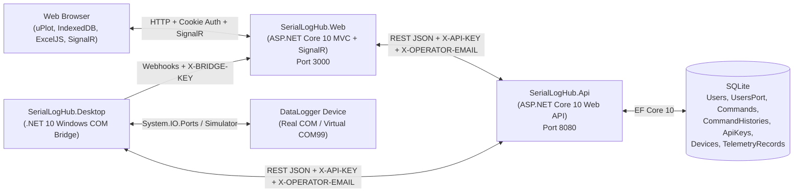
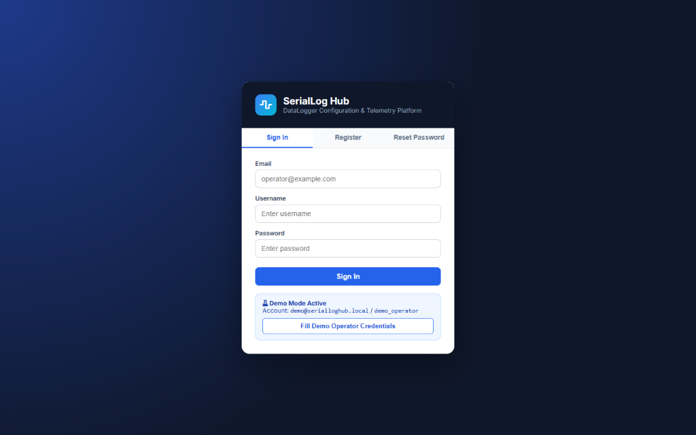
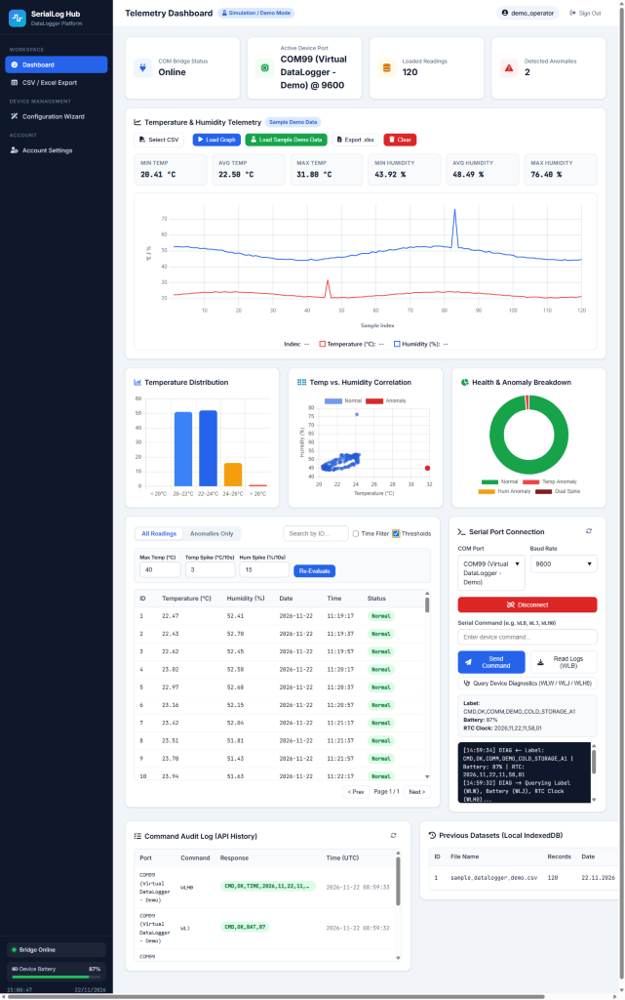
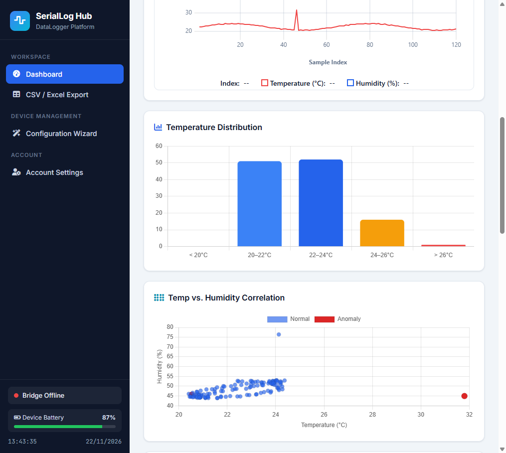
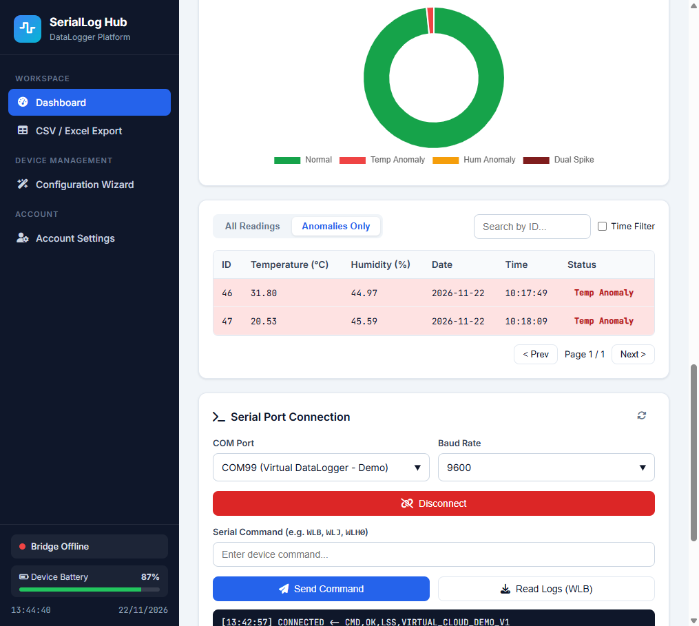
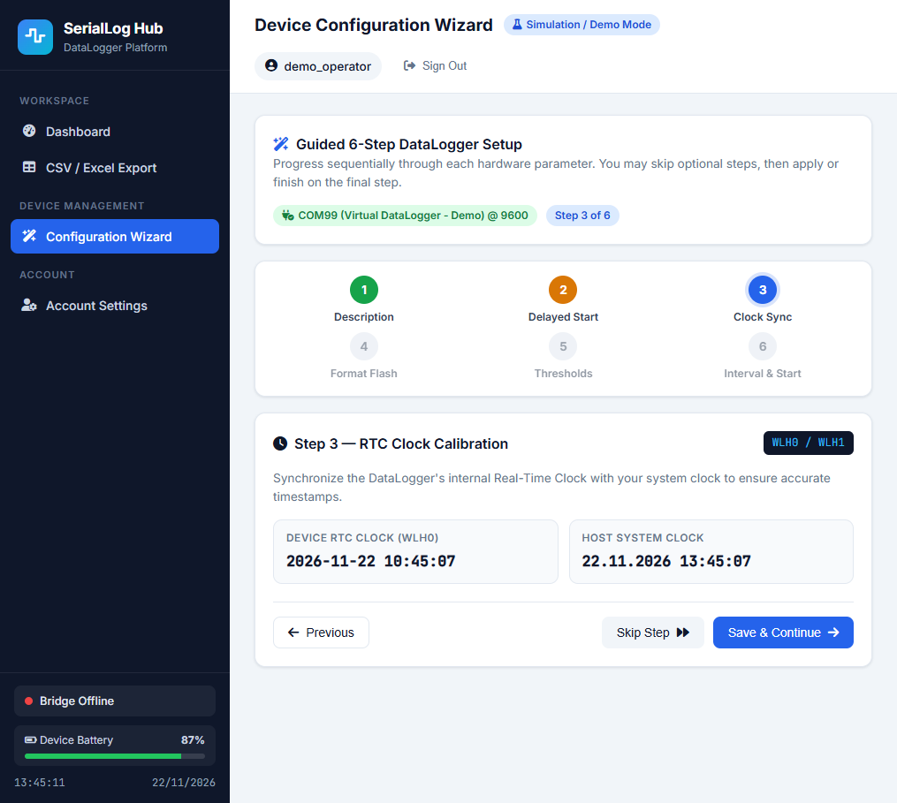

# SerialLog Hub — Technical Documentation (English)

> **[Türkçe Dokümantasyon (`README.tr.md`)](README.tr.md)** | **[Main Page (`README.md`)](README.md)**

[](https://github.com/Abuluc/seriallog-hub/actions/workflows/ci.yml)
[](https://dotnet.microsoft.com/)
[](https://learn.microsoft.com/aspnet/core/)
[](https://learn.microsoft.com/ef/core/)
[](tests/SerialLogHub.Tests)
[](deployment/docker-compose.yml)

## Table of Contents

1. [Project Overview](#1-project-overview)
2. [Key Features](#2-key-features)
3. [Architecture](#3-architecture)
4. [Technologies](#4-technologies)
5. [Application Components](#5-application-components)
6. [Screenshots](#6-screenshots)
7. [Live Demo](#7-live-demo)
8. [Demo Account](#8-demo-account)
9. [Installation](#9-installation)
10. [Configuration](#10-configuration)
11. [API Documentation](#11-api-documentation)
12. [Database Structure](#12-database-structure)
13. [Testing](#13-testing)
14. [Security](#14-security)
15. [Known Limitations](#15-known-limitations)
16. [Roadmap](#16-roadmap)
17. [License](#17-license)

---

## 1. Project Overview

**SerialLog Hub** is a three-tier DataLogger management platform built with **.NET 10 LTS** for configuring USB/RS-232 serial temperature & humidity DataLogger devices, bridging local Windows COM ports to a web workspace, detecting measurement anomalies with a 6-method deterministic statistical engine, persisting server-side historical telemetry, and visualizing high-density time-series data.

Originally started as an internship prototype, the system was audited, security-hardened, and re-engineered into a modular, testable architecture with an isolated **Virtual DataLogger Simulator** so developers can evaluate the entire workflow without physical hardware.

---

## 2. Key Features

- **Multi-Chart Telemetry Analytics:**
  - **Time-Series Telemetry Chart (uPlot):** Dual-series Temperature (°C) and Humidity (%) over time with hover tooltips and live **Min / Avg / Max** stat strip.
  - **Temperature Distribution Histogram (Chart.js):** Frequency distribution across thermal buckets (`<20°C`, `20–22°C`, `22–24°C`, `24–26°C`, `>26°C`).
  - **Temperature vs. Humidity Correlation Scatter Plot (Chart.js):** Plots every measurement with normal points in blue and anomaly outliers highlighted in red.
  - **Health & Anomaly Breakdown Doughnut (Chart.js):** Visualizes Normal vs. Temperature Anomaly vs. Humidity Anomaly vs. Dual Spike proportions.
- **Adjustable Anomaly Detection:** Flags sudden rate-of-change spikes and out-of-range temperature/humidity readings with live user-configurable thresholds (`Max Temp °C`, `ΔT/10s`, `ΔH/10s`) and composable filtering (All/Anomalies + Index Search + Time Range).
- **One-Click Device Diagnostics & Command Audit Log:** Sequentially queries Device Label (`WLW`), Battery (`WLJ`), and RTC Clock (`WLH0`) into an inline diagnostics strip, while recording every executed command and error in the live API-backed **Command Audit Log** (`GET /api/user/history`).
- **Guided 6-Step Device Configuration Wizard:** Single-entry sequential workflow from the sidebar (no ad-hoc sidebar jumping) with **Previous**, **Skip Step**, **Save & Continue**, visual progress stepper (Completed / Skipped / Active), and final summary screen covering Device Description (`WLG`/`WLW`), Delayed Start (`WLS0`), RTC Clock Calibration (`WLH0`/`WLH1`), Flash Memory Format (`WLE1`), Alarm Thresholds (`WLM`), and Sampling Interval / Auto-Start (`WLA`/`WLV1`).
- **Strict COM Port Handshake & WMI Discovery:** Enumerates physical Windows COM ports with friendly hardware names (`Win32_SerialPort`), validates `CMD,OK,LCZ,` / `CMD,OK,LSS,` handshakes to prevent false-positive connections on unrelated ports, and streams `WLB` logs over SignalR.
- **Browser IndexedDB History & Excel Export:** Persists uploaded CSV datasets and device dumps locally in IndexedDB and exports filtered tables to `.xlsx` via ExcelJS.
- **Isolated Demo & Simulation Mode:** Supports both local Desktop Virtual COM Port (`COM99`) and optional Cloud Demo Responder for zero-hardware evaluation.

---

## 3. Architecture



Detailed sequence diagrams and engineering reports are documented in:
- [docs/architecture/ARCHITECTURE.md](docs/architecture/ARCHITECTURE.md)
- [docs/FINAL_ENGINEERING_REPORT.md](docs/FINAL_ENGINEERING_REPORT.md)
- [docs/SECURITY_REVIEW.md](docs/SECURITY_REVIEW.md)
- [docs/COM_BRIDGE_RELIABILITY.md](docs/COM_BRIDGE_RELIABILITY.md)
- [docs/TELEMETRY_STORAGE.md](docs/TELEMETRY_STORAGE.md)
- [docs/ANOMALY_DETECTION.md](docs/ANOMALY_DETECTION.md)
- [docs/SIGNALR_ARCHITECTURE.md](docs/SIGNALR_ARCHITECTURE.md)

---

## 4. Technologies

| Layer | Stack |
| :--- | :--- |
| **Backend API** | C#, .NET 10 LTS, ASP.NET Core Web API, EF Core 10, SQLite, Swagger/OpenAPI, Built-in Rate Limiter |
| **Web Dashboard** | ASP.NET Core 10 MVC, SignalR, Cookie Auth, uPlot, Chart.js 4, IndexedDB, ExcelJS, FileSaver.js, Toastr |
| **Desktop COM Bridge** | .NET 10 Windows Forms (`net10.0-windows`), `System.IO.Ports`, `System.Management` (WMI) |
| **Testing & DevOps** | xUnit (45 tests), GitHub Actions CI, Docker, Docker Compose, Render Blueprint (`deployment/render.yaml`) |

---

## 5. Application Components

1. **`src/SerialLogHub.Api`**: Central REST API managing authentication, per-user COM port registries, asynchronous command queues, command history auditing, and optional `CloudDemoResponderService` (for cloud demo deployments).
2. **`src/SerialLogHub.Web`**: Operator web portal with KPI cards, telemetry charts, anomaly filtering, IndexedDB dataset history, Excel export, and 6 device configuration screens.
3. **`src/SerialLogHub.Desktop`**: Windows desktop bridge with `ISerialTransport` separating physical hardware (`RealSerialTransport`) from the optional virtual simulator (`SimulatedSerialTransport`).

---

## 6. Screenshots

| Login Screen (with Demo Helper) | Telemetry Dashboard, Stats & uPlot Chart |
| :---: | :---: |
|  |  |

| Multi-Chart Analytics (Histogram & Scatter) | Anomaly Table & Connected Serial Terminal |
| :---: | :---: |
|  |  |

| Guided 6-Step Device Configuration Wizard (Sequential + Skip) |
| :---: |
|  |

---

## 7. Live Demo

- **Web Dashboard:** [https://serialloghub-web.onrender.com](https://serialloghub-web.onrender.com)
- **Backend REST API Health:** [https://serialloghub-api.onrender.com/api/health](https://serialloghub-api.onrender.com/api/health)

> **Note:** Hosted on Render Free Tier with automatic HTTPS. If the instance has been idle, the first request may take 30–50 seconds to spin up. Click **"Fill Demo Operator Credentials"** on `/Login` to explore the dashboard, interactive uPlot telemetry, anomaly detection, and Virtual DataLogger (`COM99`) configuration.

See [docs/demo/DEMO_GUIDE.md](docs/demo/DEMO_GUIDE.md) for self-hosting via Docker Compose or Render Blueprint.

---

## 8. Demo Account

When running in **Demo / Simulation Mode**, the UI displays a clear **Simulation / Demo Mode** badge and interacts with a simulated DataLogger (`COM99 (Virtual DataLogger - Demo)`), not physical hardware:

- **Demo Email (Configured via environment variable):** `demo@serialloghub.example` *(default local dev: `demo@serialloghub.local`)*
- **Demo Username:** `demo_operator`
- **Demo Password:** Configured via `DemoMode__DemoPassword` environment variable (never commit production passwords to source control).
- **Safeguards:** Non-privileged account, username/account modification blocked, fixed-window IP rate limiting (180 req/min), and automatic 60-minute demo state reset in cloud mode.

---

## 9. Installation

### Prerequisites
- **.NET 10.0 LTS SDK** (Windows 10/11 required for `SerialLogHub.Desktop`; API and Web are cross-platform)
- Optional: **Docker & Docker Compose** for containerized deployment

### Local Setup
```powershell
# 1. Clone and build all projects
dotnet build SerialLogHub.sln

# 2. Run unit tests
dotnet test SerialLogHub.sln

# 3. Start all 3 apps locally
./scripts/run-local.ps1
```

### Docker Compose (Web + API Cloud Demo)
```bash
cp .env.example .env
# Update secrets in .env before starting
docker compose -f deployment/docker-compose.yml up --build
```

---

## 10. Configuration

Copy [.env.example](.env.example) and configure via environment variables or `appsettings.Development.json`:

- `ConnectionStrings__DefaultConnection`: SQLite database path (e.g., `Data Source=serialloghub.db`).
- `ApiSecurity__ApiKey`: Shared secret required in `X-API-KEY` header.
- `BridgeSecurity__BridgeKey`: Shared secret required in `X-BRIDGE-KEY` header for Desktop-to-Web webhooks.
- `DemoMode__Enabled` & `DemoMode__CloudVirtualDeviceResponder`: Controls Demo Mode seeding and cloud virtual device simulation.

---

## 11. API Documentation

Interactive Swagger UI is available at `http://localhost:8080/swagger` in Development mode.  
Full endpoint contracts and SignalR Hub documentation are in [docs/api/API_DOCUMENTATION.md](docs/api/API_DOCUMENTATION.md).

---

## 12. Database Structure

`SerialLogHub.Api` uses **SQLite** via EF Core 10 with 7 tables:

- **`Users`**: `Id`, `Username`, `Email` (unique), `HashedPassword` (salted PBKDF2), `IsEmailVerified`, `VerificationToken`, `ResetPasswordToken`, `TokenExpiryTime`
- **`UsersPort`**: `Id`, `UserEmail` (unique), `Ports` (JSON array of detected COM ports)
- **`Commands`**: `Id`, `Email`, `SelecetdPort`, `BaudRate`, `Message`, `Timestamp`, `CommandID`, `IsProcessed`, `Response`, `Status` (`Pending` / `Dispatched` / `Completed` / `Failed` / `TimedOut`), `DispatchedAt`, `CompletedAt`, `ErrorCategory`, `AttemptCount`
- **`CommandHistories`**: Permanent audit log of processed commands and device responses
- **`ApiKeys`**: `Id`, `Key` (unique), `ExpiresAt`
- **`Devices`**: `Id`, `UserEmail`, `DeviceName`, `PortName`, `SerialNumber`, `CreatedAt`, `LastSeenUtc`
- **`TelemetryRecords`**: `Id`, `DeviceId`, `UserEmail`, `PortName`, `Temperature`, `Humidity`, `RecordedAt`, `IngestedAt`, `IsAnomaly`, `AnomalySeverity`, `AnomalyMethod`, `AnomalyExplanation`, `RawPayload`

---

## 13. Testing

- **Automated Test Suite (`dotnet test SerialLogHub.sln`):** **45/45 xUnit tests passing** (`PasswordSecurityServiceTests`, `SerialTransportTests`, `UserControllerTests`, `WebLayerTests`, `AnomalyDetectionEngineTests`, `TelemetryAndSecurityTests`).
- **End-to-End 3-Tier Verification:** Verified `SerialLogHub.Api` + `SerialLogHub.Web` + `SerialLogHub.Desktop` (headless virtual device) across authentication, BOLA/IDOR blocking, WMI + virtual port sync, `TEST`, `WLJ`, `WLG`/`WLW`, `WLH0`, and `WLB` telemetry streaming & SQLite persistence.
- **Browser UI Verification:** Verified zero console errors across Login, Dashboard, uPlot + Chart.js charting, Anomaly filtering, Virtual COM connection, Server Telemetry Archive, and Guided 6-Step Device Configuration Wizard.

---

## 14. Security

See [SECURITY.md](SECURITY.md) for full details. Key controls include zero direct client database access, salted PBKDF2 password storage, signed cookie claims, `[Authorize]` SignalR Hub, `X-API-KEY` / `X-BRIDGE-KEY` headers, fixed-window rate limiting, and demo account isolation.

---

## 15. Known Limitations

- **Physical Hardware Verification:** End-to-end tests during refactoring were executed against `SimulatedSerialTransport` because no physical DataLogger unit was connected; `RealSerialTransport` preserves the original verified `System.IO.Ports` protocol and should be validated with physical hardware before field deployment.
- **SMTP Email Delivery:** Verification and password-reset tokens are generated and logged; an external SMTP provider should be plugged in for production email delivery.
- **Single-Node SignalR:** `UserConnectionManager` stores active connections in memory (use Redis backplane for multi-instance scaling).

---

## 16. Roadmap

- Plug-in SMTP / SendGrid email provider for production verification flows.
- Persistent server-side telemetry archival & multi-device fleet comparison view.
- Cross-platform serial bridge daemon (Linux/macOS support via .NET Worker Service).
- Automated CI/CD GitHub Actions workflow (`dotnet build`, `dotnet test`, Docker image build).

---

## 17. License

This project is licensed under the **MIT License** — see the [LICENSE](LICENSE) file for details.
