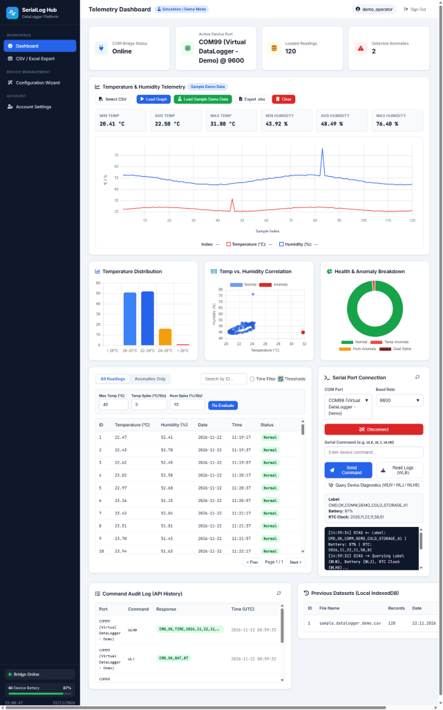
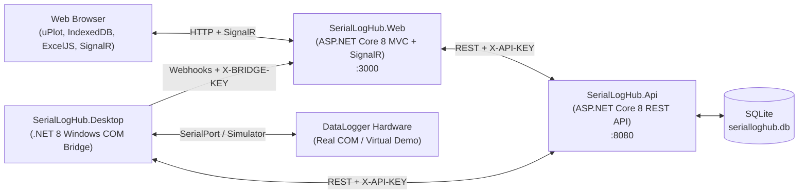

<div align="center">

# SerialLog Hub

**A three-tier DataLogger management platform for serial device configuration, COM port bridging, anomaly detection, and interactive telemetry visualization.**

[](https://dotnet.microsoft.com/)
[](https://learn.microsoft.com/aspnet/core/)
[](https://learn.microsoft.com/aspnet/core/signalr/)
[](https://www.sqlite.org/)
[](LICENSE)
[](https://serialloghub-web.onrender.com)

---

### Live Demo / Canlı Demo

**[Launch Live Web Demo (`serialloghub-web.onrender.com`)](https://serialloghub-web.onrender.com)** &nbsp;|&nbsp; **[API Health Check (`serialloghub-api.onrender.com/api/health`)](https://serialloghub-api.onrender.com/api/health)**

*(Hosted on Render Free Tier — initial cold start may take 30–50 seconds. Use **"Fill Demo Operator Credentials"** on the login page.)*

### Choose Your Language / Dil Seçimi

**[Read Full Documentation in English (`README.en.md`)](README.en.md)** &nbsp;|&nbsp; **[Türkçe Detaylı Dokümantasyonu Oku (`README.tr.md`)](README.tr.md)**

</div>

---

## Quick Preview



## System Overview



## Quick Start (Local Development)

```powershell
# Build and run automated tests
dotnet build SerialLogHub.sln
dotnet test SerialLogHub.sln

# Launch API (:8080), Web Dashboard (:3000), and Desktop COM Bridge
./scripts/run-local.ps1
```

## Documentation Index

- **[English Documentation (`README.en.md`)](README.en.md)** — Complete 17-section technical guide.
- **[Türkçe Dokümantasyon (`README.tr.md`)](README.tr.md)** — 17 bölümlük tam Türkçe rehber.
- **[Architecture (`docs/architecture/ARCHITECTURE.md`)](docs/architecture/ARCHITECTURE.md)** — Sequence diagrams and security boundaries.
- **[API Reference (`docs/api/API_DOCUMENTATION.md`)](docs/api/API_DOCUMENTATION.md)** — REST endpoints and SignalR Hub contract.
- **[Live Demo & Cloud Deployment (`docs/demo/DEMO_GUIDE.md`)](docs/demo/DEMO_GUIDE.md)** — Docker Compose, Render blueprint, and hosting guide.
- **[Security Policy (`SECURITY.md`)](SECURITY.md)** — Security controls and vulnerability reporting.
