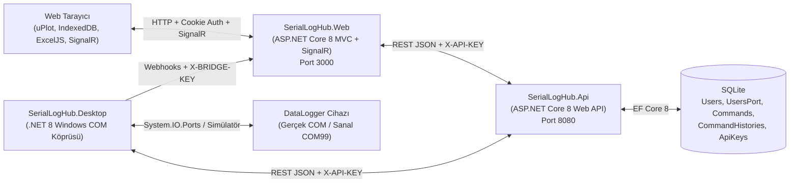
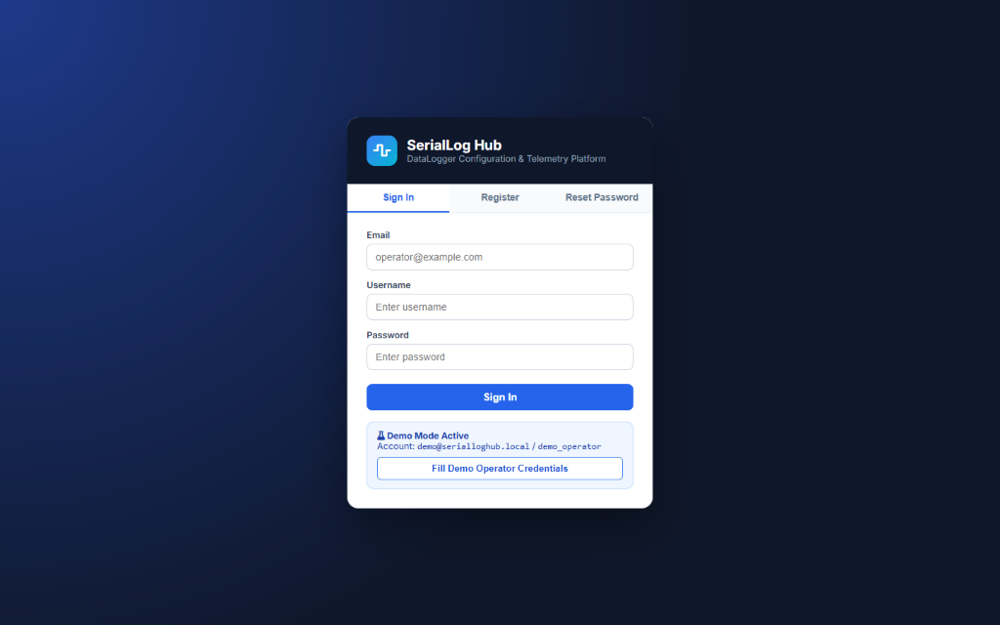
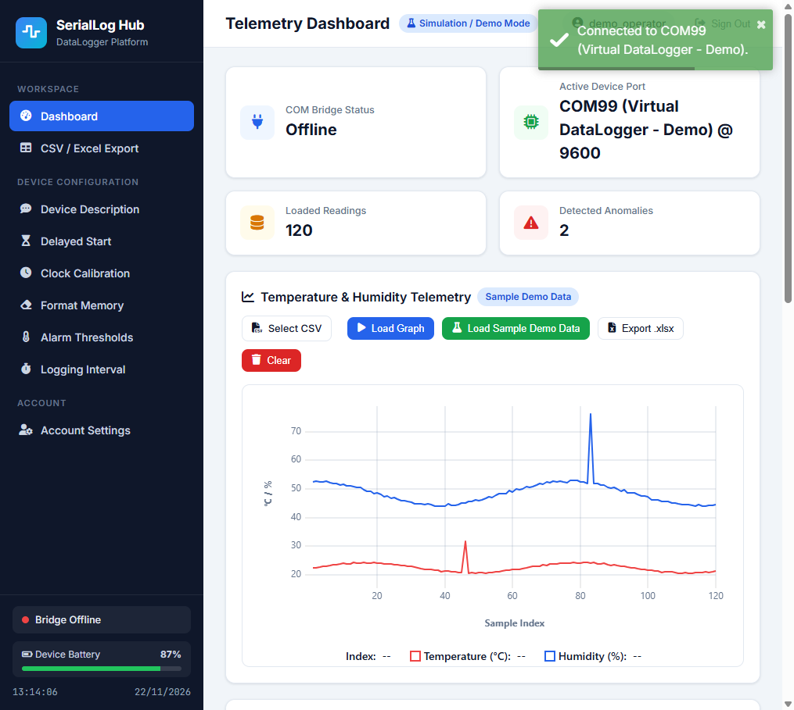
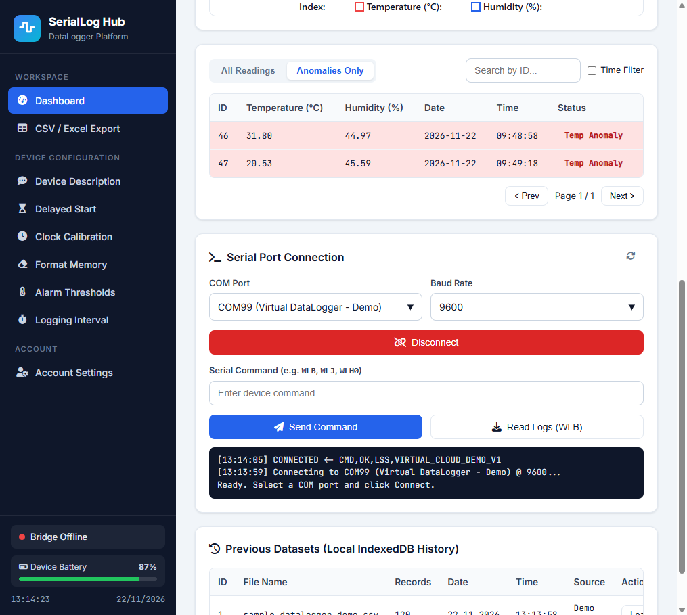
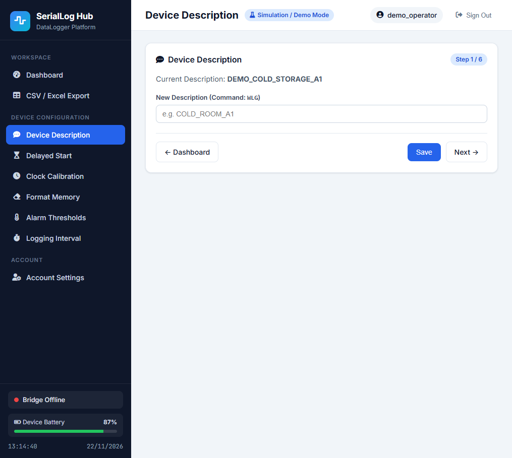
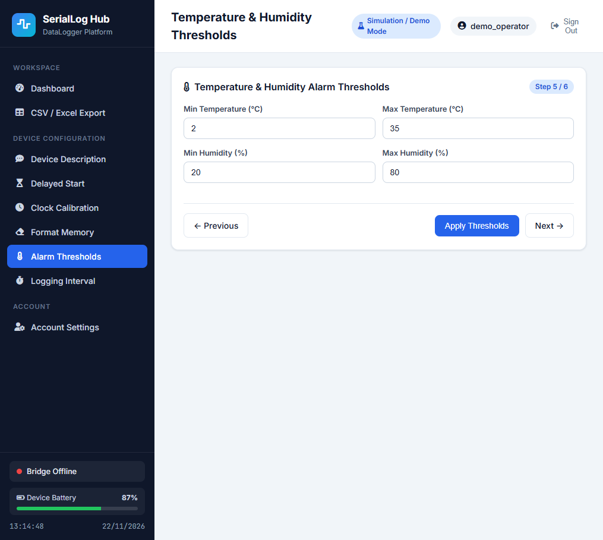

# SerialLog Hub — Teknik Dokümantasyon (Türkçe)

> **[English Documentation (`README.en.md`)](README.en.md)** | **[Ana Sayfa (`README.md`)](README.md)**

[](https://dotnet.microsoft.com/)
[](https://learn.microsoft.com/aspnet/core/)
[](https://learn.microsoft.com/ef/core/)
[](tests/SerialLogHub.Tests)
[](deployment/docker-compose.yml)

## İçindekiler

1. [Proje Hakkında](#1-proje-hakkında)
2. [Temel Özellikler](#2-temel-özellikler)
3. [Mimari](#3-mimari)
4. [Kullanılan Teknolojiler](#4-kullanılan-teknolojiler)
5. [Uygulama Bileşenleri](#5-uygulama-bileşenleri)
6. [Ekran Görüntüleri](#6-ekran-görüntüleri)
7. [Canlı Demo](#7-canlı-demo)
8. [Demo Hesabı](#8-demo-hesabı)
9. [Kurulum](#9-kurulum)
10. [Yapılandırma](#10-yapılandırma)
11. [API Dokümantasyonu](#11-api-dokümantasyonu)
12. [Veritabanı Yapısı](#12-veritabanı-yapısı)
13. [Testler](#13-testler)
14. [Güvenlik](#14-güvenlik)
15. [Bilinen Eksiklikler](#15-bilinen-eksiklikler)
16. [Gelecek Geliştirmeler](#16-gelecek-geliştirmeler)
17. [Lisans](#17-lisans)

---

## 1. Proje Hakkında

**SerialLog Hub**, USB/RS-232 seri port üzerinden bağlanan sıcaklık ve nem DataLogger cihazlarının konfigürasyonunu yapmak, yerel Windows COM portlarını web arayüzüne köprülemek, ölçüm anomalilerini tespit etmek ve yüksek hacimli telemetri verilerini etkileşimli grafiklerle görüntülemek için **.NET 8** ile geliştirilmiş üç katmanlı bir yönetim platformudur.

Staj dönemindeki bir prototip olarak başlayan proje; kapsamlı güvenlik denetimi, temiz kod standartları ve gerçek donanım olmadan tüm akışın denenebilmesini sağlayan izole **Sanal DataLogger Simülatörü** ile baştan yapılandırılmıştır.

---

## 2. Temel Özellikler

- **Etkileşimli Telemetri Grafiği:** Yüksek performanslı **uPlot** kütüphanesi ile sıcaklık (°C) ve nem (%) zaman serisi çizimi ve özel imleç ipuçları.
- **Otomatik Anomali Tespiti:** Ani değişim sıçramalarını ve eşik dışı sıcaklık/nem değerlerini işaretler; **Anomalies Only** sekmesi ile hatalı ölçümleri filtreler.
- **6 Adımlı Cihaz Konfigürasyon Sihirbazı:** Cihaz Açıklaması (`WLG`/`WLW`), Gecikmeli Başlatma (`WLS0`), RTC Saat Kalibrasyonu (`WLH0`/`WLH1`), Bellek Biçimlendirme (`WLE1`), Alarm Eşikleri (`WLM`) ve Örnekleme Aralığı / Otomatik Başlatma (`WLA`/`WLV1`).
- **WMI Destekli COM Port Köprüsü:** Windows COM portlarını donanım açıklamalarıyla (`Win32_SerialPort`) listeler ve `WLB` veri akışını SignalR üzerinden web arayüzüne aktarır.
- **Tarayıcı IndexedDB Geçmişi ve Excel Dışa Aktarma:** Yüklenen CSV dosyalarını ve cihaz dökümlerini tarayıcıda saklar; ExcelJS ile `.xlsx` formatında dışa aktarır.
- **İzole Demo ve Simülasyon Modu:** Hem yerel Masaüstü Sanal COM Port (`COM99`) hem de bulut ortamı için opsiyonel `CloudDemoResponderService` desteği sunar.

---

## 3. Mimari



Ayrıntılı akış diyagramları için [docs/architecture/ARCHITECTURE.md](docs/architecture/ARCHITECTURE.md) dosyasına bakabilirsiniz.

---

## 4. Kullanılan Teknolojiler

| Katman | Teknolojiler |
| :--- | :--- |
| **Backend API** | C#, .NET 8, ASP.NET Core Web API, EF Core 8, SQLite, Swagger/OpenAPI, Dahili Rate Limiter |
| **Web Dashboard** | ASP.NET Core 8 MVC, SignalR, Cookie Auth, uPlot, IndexedDB, ExcelJS, FileSaver.js, Toastr |
| **Masaüstü COM Köprüsü** | .NET 8 Windows Forms (`net8.0-windows`), `System.IO.Ports`, `System.Management` (WMI) |
| **Test ve Dağıtım** | xUnit, Docker, Docker Compose, Render Blueprint (`deployment/render.yaml`) |

---

## 5. Uygulama Bileşenleri

1. **`src/SerialLogHub.Api`**: Kimlik doğrulama, kullanıcı bazlı COM port kaydı, asenkron komut kuyruğu, komut geçmişi ve bulut demo yanıtlayıcısını (`CloudDemoResponderService`) yöneten merkezi REST API.
2. **`src/SerialLogHub.Web`**: KPI kartları, telemetri grafikleri, anomali filtresi, IndexedDB veri geçmişi, Excel dışa aktarma ve 6 cihaz ayar ekranını barındıran web uygulaması.
3. **`src/SerialLogHub.Desktop`**: Fiziksel donanım iletişimini (`RealSerialTransport`) opsiyonel sanal simülatörden (`SimulatedSerialTransport`) `ISerialTransport` arayüzüyle tamamen ayıran Windows COM Port köprüsü.

---

## 6. Ekran Görüntüleri

| Giriş Ekranı (Demo Yardımcılı) | Telemetri Dashboard & uPlot Grafiği |
| :---: | :---: |
|  |  |

| Anomali Tablosu & Bağlı Seri Port Terminali | Cihaz Açıklama Ayarı (`WLG`/`WLW`) |
| :---: | :---: |
|  |  |

| Alarm Eşik Ayarları (`WLM`) |
| :---: |
|  |

---

## 7. Canlı Demo

> **Yayınlama Durumu:** Uygulama Docker (`deployment/Dockerfile.api`, `deployment/Dockerfile.web`, `deployment/docker-compose.yml`) ve Render Blueprint (`deployment/render.yaml`) ile bulut dağıtımına hazırdır ve Bulut Simülasyon Modu yerel olarak doğrulanmıştır. Seçilen hosting sağlayıcısında yayınlandığında gerçek HTTPS canlı demo bağlantısı buraya eklenecektir.

Hosting seçenekleri, maliyet karşılaştırması ve Docker kurulumu için [docs/demo/DEMO_GUIDE.md](docs/demo/DEMO_GUIDE.md) dosyasına bakabilirsiniz.

---

## 8. Demo Hesabı

**Demo / Simülasyon Modu** aktifken arayüzde **Simulation / Demo Mode** rozeti görünür ve gerçek donanım yerine sanal DataLogger (`COM99 (Virtual DataLogger - Demo)`) kullanılır:

- **Demo E-posta (Ortam değişkeni ile yapılandırılır):** `demo@serialloghub.example` *(yerel geliştirme varsayılanı: `demo@serialloghub.local`)*
- **Demo Kullanıcı Adı:** `demo_operator`
- **Demo Parola:** `DemoMode__DemoPassword` ortam değişkeni ile atanır (gerçek parolalar kaynak koduna gömülmez).
- **Koruma Önlemleri:** Yönetici yetkisiz hesap, hesap bilgisi değiştirme engeli, IP bazlı rate limiting (180 istek/dk) ve bulut modunda 60 dakikada bir otomatik demo verisi sıfırlama.

---

## 9. Kurulum

### Gereksinimler
- **.NET 8.0 SDK** (`SerialLogHub.Desktop` için Windows 10/11; API ve Web çapraz platformdur)
- Opsiyonel: Konteyner dağıtımı için **Docker & Docker Compose**

### Yerel Kurulum
```powershell
# 1. Tüm projeleri derle
dotnet build SerialLogHub.sln

# 2. Birim testlerini çalıştır
dotnet test SerialLogHub.sln

# 3. Üç uygulamayı tek komutla başlat
./scripts/run-local.ps1
```

### Docker Compose (Web + API Bulut Demo)
```bash
cp .env.example .env
# Başlatmadan önce .env içindeki anahtar ve parolaları güncelleyin
docker compose -f deployment/docker-compose.yml up --build
```

---

## 10. Yapılandırma

[.env.example](.env.example) dosyasını referans alarak ortam değişkenleri veya `appsettings.Development.json` üzerinden yapılandırın:

- `ConnectionStrings__DefaultConnection`: SQLite veritabanı yolu (`Data Source=serialloghub.db`).
- `ApiSecurity__ApiKey`: `X-API-KEY` başlığında beklenen paylaşım anahtarı.
- `BridgeSecurity__BridgeKey`: Masaüstü → Web webhook'ları için `X-BRIDGE-KEY` anahtarı.
- `DemoMode__Enabled` ve `DemoMode__CloudVirtualDeviceResponder`: Demo verisi ve bulut sanal cihaz yanıtlayıcı ayarları.

---

## 11. API Dokümantasyonu

Geliştirme modunda etkileşimli Swagger arayüzüne `http://localhost:8080/swagger` adresinden ulaşılabilir.  
Tüm endpoint sözleşmeleri ve SignalR Hub detayları [docs/api/API_DOCUMENTATION.md](docs/api/API_DOCUMENTATION.md) dosyasındadır.

---

## 12. Veritabanı Yapısı

`SerialLogHub.Api`, EF Core 8 ile **SQLite** üzerinde 5 tablo yönetir:

- **`Users`**: `Id`, `Username`, `Email` (benzersiz), `HashedPassword` (tuzlu PBKDF2), `IsEmailVerified`, `VerificationToken`, `ResetPasswordToken`, `TokenExpiryTime`
- **`UsersPort`**: `Id`, `UserEmail` (benzersiz), `Ports` (tespit edilen COM portlarının JSON listesi)
- **`Commands`**: `Id`, `Email`, `SelecetdPort`, `BaudRate`, `Message`, `Timestamp`, `CommandID`, `IsProcessed`, `Response`
- **`CommandHistories`**: İşlenen komut ve cihaz yanıtlarının kalıcı denetim geçmişi
- **`ApiKeys`**: `Id`, `Key` (benzersiz), `ExpiresAt`

---

## 13. Testler

- **Otomatik Birim Testleri (`dotnet test`):** 6/6 xUnit testi başarılı (`PasswordSecurityServiceTests`, `SerialTransportTests`).
- **3 Katmanlı Uçtan Uca Entegrasyon Testi:** `SerialLogHub.Api` + `SerialLogHub.Web` + `SerialLogHub.Desktop` birlikte çalıştırılarak kimlik doğrulama, WMI + sanal port eşitlemesi, `TEST`, `WLJ`, `WLG`/`WLW`, `WLH0` ve `WLB` 60 satırlık veri akışı doğrulandı.
- **Tarayıcı Arayüz Doğrulaması:** Login, Dashboard, uPlot grafiği, Anomali filtresi, Sanal COM bağlantısı ve Cihaz Konfigürasyon ekranlarında sıfır tarayıcı konsol hatası doğrulandı.

---

## 14. Güvenlik

Ayrıntılar için [SECURITY.md](SECURITY.md) dosyasına bakabilirsiniz. İstemcilerin doğrudan veritabanına erişiminin kaldırılması, tuzlu PBKDF2 şifre saklama, imzalı kimlik çerezleri, `[Authorize]` SignalR Hub, `X-API-KEY` / `X-BRIDGE-KEY` koruması, IP bazlı rate limiting ve demo hesabı izolasyonu uygulanmıştır.

---

## 15. Bilinen Eksiklikler

- **Fiziksel Donanım Testi:** Yeniden yapılandırma sırasında fiziksel DataLogger cihazı bağlı olmadığı için uçtan uca testler `SimulatedSerialTransport` ile yapılmıştır; `RealSerialTransport` orijinal `System.IO.Ports` protokolünü birebir korur ancak saha kullanımından önce fiziksel cihazla doğrulanmalıdır.
- **SMTP E-posta Gönderimi:** Doğrulama ve şifre sıfırlama tokenları üretilip loglanır; üretim ortamında harici bir SMTP/SendGrid sağlayıcısı bağlanmalıdır.
- **Tek Sunuculu SignalR:** `UserConnectionManager` bağlantıları bellekte tutar (çoklu sunucu ölçeklemesi için Redis backplane gerekir).

---

## 16. Gelecek Geliştirmeler

- Üretim ortamı için SMTP / SendGrid e-posta entegrasyonu.
- Sunucu tarafı kalıcı telemetri arşivi ve çoklu cihaz karşılaştırma ekranı.
- Linux/macOS uyumlu çapraz platform seri port köprüsü (.NET Worker Service).
- GitHub Actions CI/CD hattı (`dotnet build`, `dotnet test`, Docker imaj derleme).

---

## 17. Lisans

Bu proje **MIT Lisansı** ile lisanslanmıştır — ayrıntılar için [LICENSE](LICENSE) dosyasına bakabilirsiniz.
