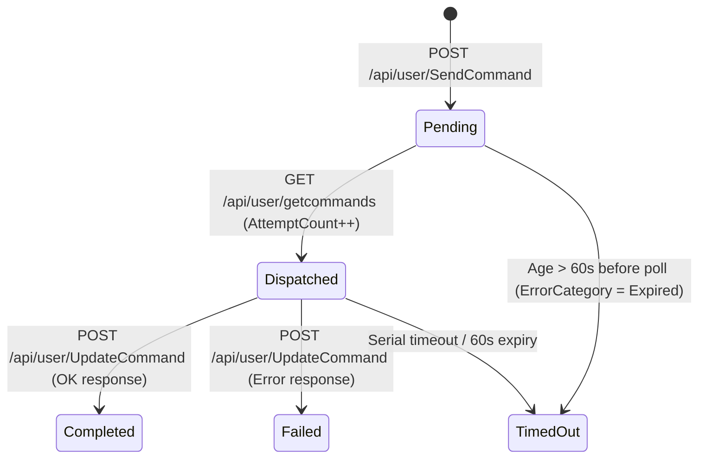

# Phase Three — Windows Desktop Serial COM Bridge Reliability

**Project:** `SerialLogHub.Desktop` (.NET 10 Windows)  
**Document Date:** 2026-11-22

---

## 1. SerialPort Lifecycle & UI Thread Isolation

`RealSerialTransport` (`src/SerialLogHub.Desktop/Services/RealSerialTransport.cs`) manages physical `System.IO.Ports.SerialPort` communication with DataLogger hardware:

1. **Off-Thread Execution:** All blocking `SerialPort.Open()`, `DiscardInBuffer()`, `DiscardOutBuffer()`, `WriteLine()`, `ReadLine()`, and WMI `Win32_SerialPort` queries execute inside `Task.Run(...)` so the Windows Forms UI thread never freezes when a Bluetooth or unresponsive COM port stalls.
2. **Cancellation-Aware Blocking Unblock:** Because `SerialPort.ReadLine()` does not natively accept a `CancellationToken`, `RealSerialTransport` registers a `cancellationToken.Register(() => { try { serialPort.Close(); } catch { } })` callback that immediately aborts a blocked `ReadLine()` when the 25-second command timeout or application shutdown fires.
3. **Deterministic Port Disposal:** `using var serialPort = new SerialPort(...)` plus `finally { if (serialPort.IsOpen) serialPort.Close(); }` ensures the OS COM handle is always released after every command, allowing physical USB unplug/replug without handle leaks.
4. **Robust WMI Port Discovery:** `ExtractRawPortName` uses `\b(COM\d+)\b` regex matching and numerical port sorting (`COM3`, `COM4`, `COM12`) so friendly device names in any format (`"COM3 (USB-SERIAL CH340)"`, `"USB-SERIAL (COM7)"`, `"COM4(BT)"`) resolve reliably.

---

## 2. Explicit Command Lifecycle State Machine

Commands in `SerialLogHub.Api` (`CommandEntity`) follow an explicit lifecycle:

Each `CommandEntity` records:
- `Status`: `Pending`, `Dispatched`, `Executing`, `Completed`, `Failed`, `TimedOut`, `Cancelled`
- `Timestamp` (queued UTC), `DispatchedAt` (polled UTC), `CompletedAt` (finished UTC)
- `AttemptCount` and `ErrorCategory` (`None`, `Timeout`, `PortNotFound`, `DeviceError`, `Expired`)

---

## 3. Idempotency & Non-Idempotent Physical Command Protection

Physical DataLogger commands fall into two categories:
- **Read-Only / Idempotent Commands:** `TEST` (handshake), `WLB` (read flash log), `WLJ` (read battery), `WLW` (read label), `WLH0` (read RTC clock).
- **State-Mutating / Non-Idempotent Commands (`BridgeEngine.IsNonIdempotentPhysicalCommand`):**
  - `WLE1` (Erase/Format flash memory)
  - `WLH1` (Write RTC clock)
  - `WLS0` (Write delayed start)
  - `WLM` (Write alarm thresholds)
  - `WLA` (Write sampling interval)
  - `WLV1` (Trigger auto-start)
  - `WLG` (Write device label)

**Safety Guarantees:**
1. `UserController.SendCommand` enforces idempotency on `(Email, CommandID)`.
2. `BridgeEngine` tracks `_completedCommandIds` and `_dispatchedNonIdempotentIds`: a state-mutating command (`WLE1`, `WLH1`, etc.) is **never** executed twice on physical hardware even if a network glitch occurs while reporting the response.
3. `BridgeApiClient.UpdateCommandResponseAsync` retries reporting the completed result back to the API (`0ms`, `250ms`, `750ms` backoff) without re-running the serial command.

---

## 4. Adaptive Polling & Exponential Error Backoff

`BridgeEngine.PollAndExecuteNextCommandAsync` dynamically adapts its polling cadence:
- **Active Mode (`0ms` extra delay):** When commands are arriving or ports change, the bridge polls at full responsiveness.
- **Idle Backoff:** After `15` consecutive empty polls, polling backs off by `+1200ms`; after `40` consecutive empty polls, it backs off by `+2500ms`, cutting idle HTTP traffic by >60%.
- **Network Error Backoff:** On transient API connection errors, `_consecutiveErrorCount` applies exponential backoff (`2s`, `4s`, `8s`, capped at `10s`) and automatically recovers to `0` on the next successful poll.
