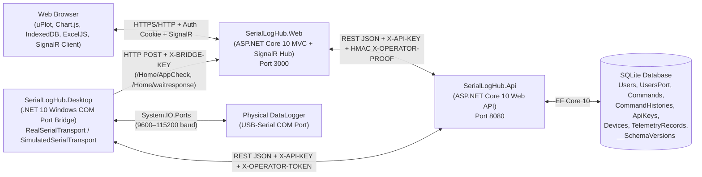
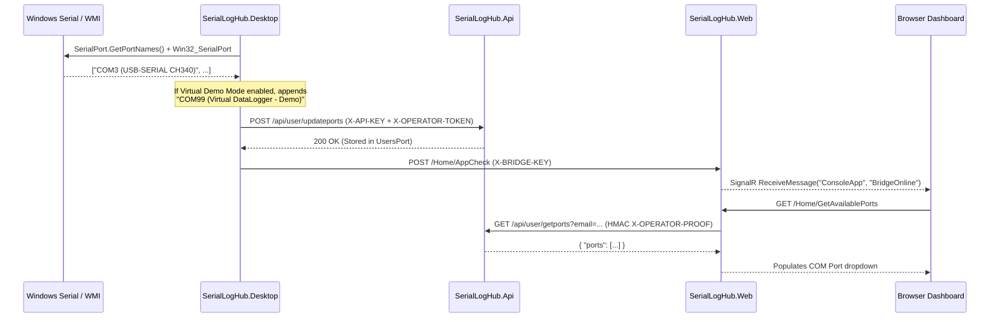
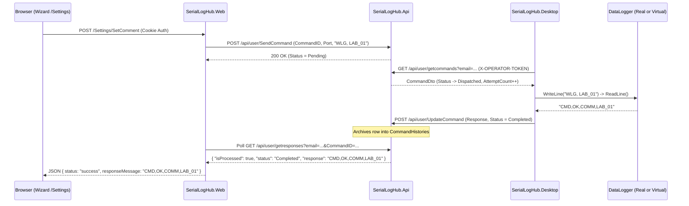

# System Architecture (`ARCHITECTURE.md`)

## 1. High-Level Three-Tier Architecture (.NET 10 LTS)

**SerialLog Hub** separates browser-based visualization, backend command/telemetry orchestration, and local Windows COM port hardware access into three decoupled **.NET 10 LTS** applications:

---

## 2. COM Port Discovery & Synchronization Flow

The Desktop Bridge continuously monitors local Windows COM ports (with WMI friendly device descriptions from `Win32_SerialPort`) and optionally exposes an isolated Virtual DataLogger (`COM99`) for hardware-free demonstrations.

---

## 3. Device Configuration Command Flow (User -> DataLogger)

All 6 guided device configuration steps (Description `WLG`, Delayed Start `WLS0`, Clock Sync `WLH1`, Flash Format `WLE1`, Alarm Thresholds `WLM`, Sampling Interval `WLA`, Auto-Start `WLV1`) follow an explicit command lifecycle (`Pending -> Dispatched -> Completed / Failed / TimedOut`):

---

## 4. Telemetry Dump, Statistical Anomaly Analysis & Persistent SQLite Storage Flow

When the operator triggers a log dump (`WLB`), the Desktop Bridge streams serial chunks until the end-of-stream marker (`CMD,OK,LSD,`), pushing progress updates to the Web App's SignalR Hub (`DataReading`) and returning the complete CSV dataset to the API, which automatically runs the 6-method deterministic `AnomalyDetectionEngine` and persists records into `Devices` and `TelemetryRecords`.

---

## 5. Security Boundaries

- **Zero Direct Client Database Access:** Neither `SerialLogHub.Web` nor `SerialLogHub.Desktop` connects to SQLite directly. All persistence flows through `SerialLogHub.Api`.
- **Fail-Closed Operator Identity Binding (`OperatorScopeGuard`):**
  - Null authentication context, missing operator headers, or bare unverified `X-OPERATOR-EMAIL` headers always fail closed (`401 Unauthorized`).
  - `SerialLogHub.Desktop` receives a database-backed, SHA-256-hashed, operator-scoped session token (`X-OPERATOR-TOKEN`) upon login (`POST /api/auth/login`), bound to `ApiKeyEntity.OwnerEmail`.
  - `SerialLogHub.Web` signs proxied operator requests with a timestamped `HMAC-SHA256` signature (`X-OPERATOR-PROOF` + `X-OPERATOR-TIMESTAMP` within a $\pm 300\text{s}$ replay window).
  - Any mismatch between the authenticated credential owner and the requested `email` resource returns `403 Forbidden` (blocking BOLA/IDOR).
- **Production Startup Validation (`ProductionSecurityValidator`):** Rejects disabled API key checks, short keys (`< 16 chars`), and development fallback secrets (`dev-serialloghub-api-key`, `CHANGE_ME_IN_PRODUCTION`, `Demo1234!`) in Production.
- **Constant-Time Secret Comparison:** All API keys, Bridge keys, HMAC proofs, and password reset tokens are compared using `CryptographicOperations.FixedTimeEquals`.
