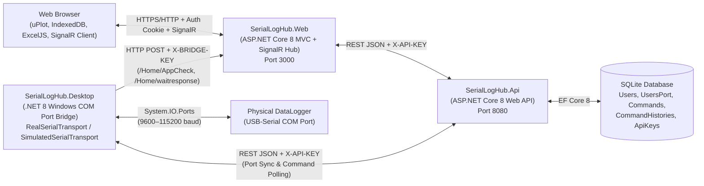
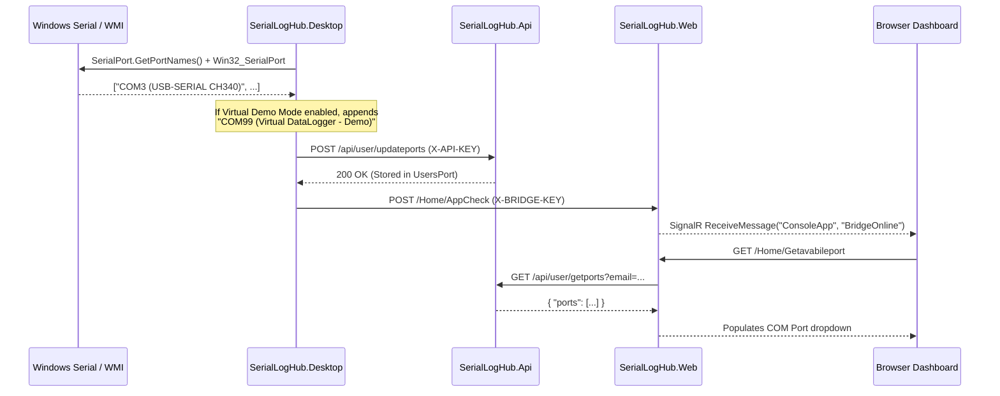
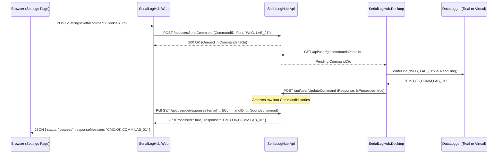
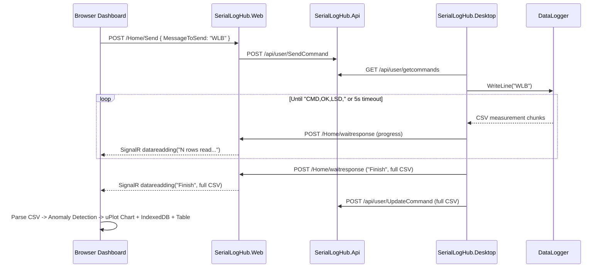

# System Architecture (`ARCHITECTURE.md`)

## 1. High-Level Three-Tier Architecture

**SerialLog Hub** separates browser-based visualization, backend command/state orchestration, and local Windows COM port hardware access into three decoupled .NET 8 applications:

---

## 2. COM Port Discovery & Synchronization Flow

The Desktop Bridge continuously monitors local Windows COM ports (with WMI friendly device descriptions from `Win32_SerialPort`) and optionally exposes an isolated Virtual DataLogger for hardware-free demonstrations.

---

## 3. Device Configuration Command Flow (User -> DataLogger)

All device configuration screens (Description `WLG`, Delayed Start `WLS0`, Clock Sync `WLH1`, Flash Format `WLE1`, Alarm Thresholds `WLM`, Sampling Interval `WLA`, Auto-Start `WLV1`) follow the same reliable asynchronous command-relay pattern:

---

## 4. Telemetry Dump & Visualization Flow (DataLogger -> Web)

When the operator triggers a log dump (`WLB`), the Desktop Bridge streams serial chunks until the end-of-stream marker (`CMD,OK,LSD,`) or a 5-second inactivity timeout, pushing progress updates to the Web App's SignalR Hub and returning the complete CSV dataset.

---

## 5. Security Boundaries

- **No Direct Database Access from Clients:** Neither `SerialLogHub.Web` nor `SerialLogHub.Desktop` connects to SQLite/SQL Server directly. All persistence flows through `SerialLogHub.Api`.
- **Signed Cookie Identity:** `SerialLogHub.Web` resolves the active operator exclusively from the signed ASP.NET Core `ClaimTypes.Name` cookie claim (eliminating client-cookie spoofing).
- **Authenticated SignalR Hub:** `/notificationHub` requires `[Authorize]` and maps connections strictly by `Context.User.Identity.Name`.
- **Shared-Secret Protection:** API routes require `X-API-KEY`; Desktop-to-Web webhooks (`/Home/AppCheck`, `/Home/waitresponse`) require `X-BRIDGE-KEY`.
- **Salted PBKDF2 Password Storage:** Incoming SHA-256 client hashes are re-hashed with per-user random salt via ASP.NET Core `PasswordHasher<string>` before persistence.
